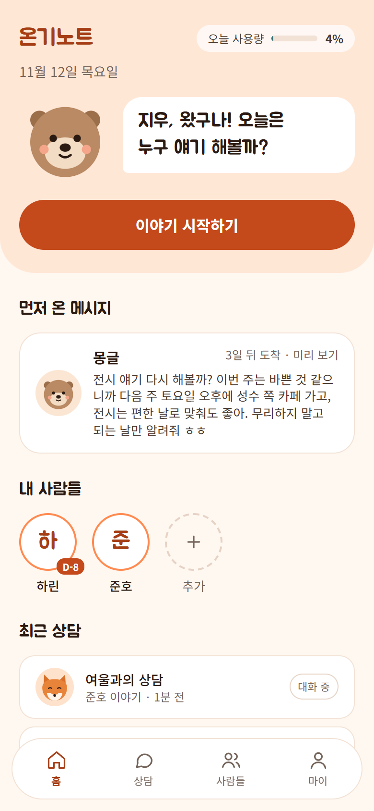
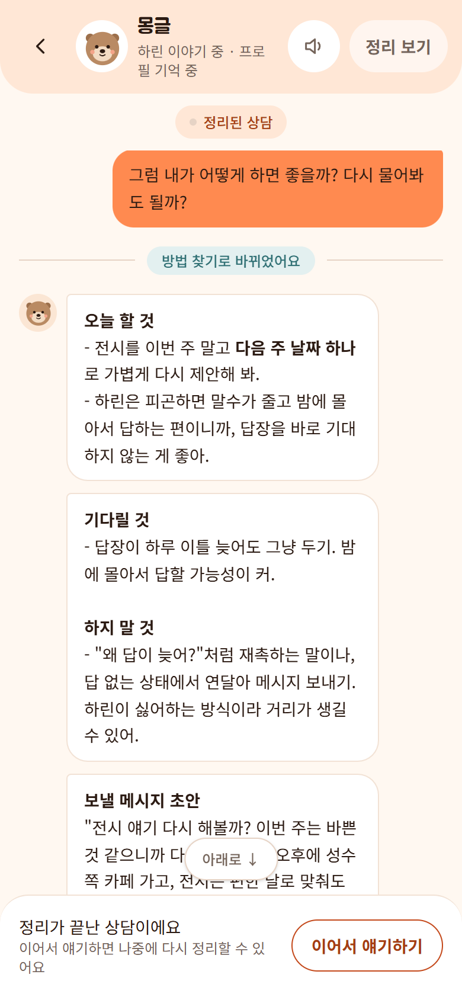
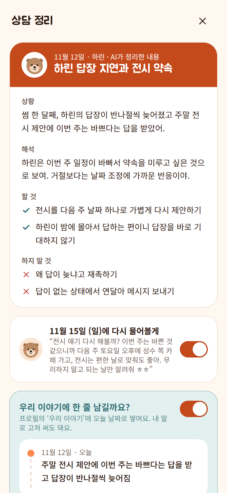
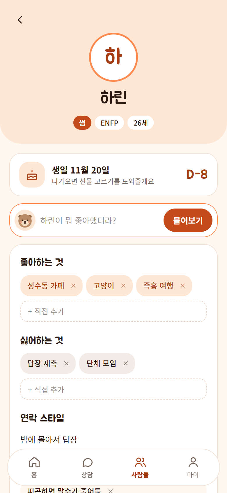
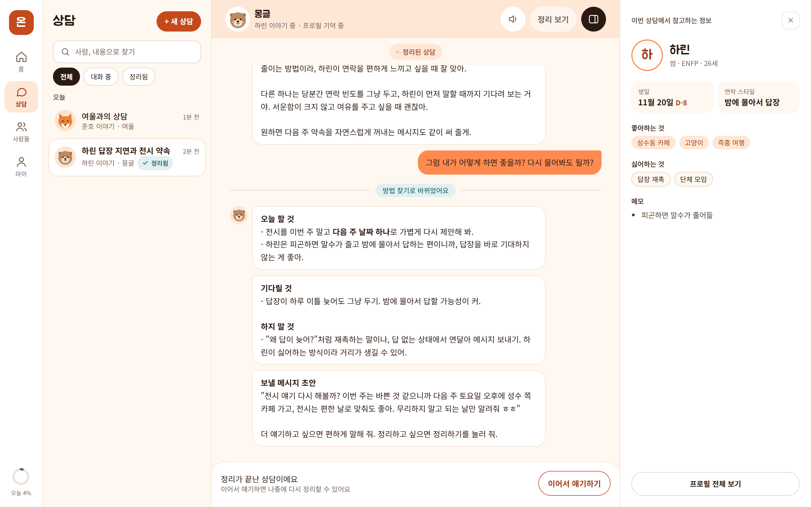

# 온기노트

**AI 캐릭터와 인간관계 고민을 이야기하고, 대화를 정리 카드와 인물 기록으로 남기는 웹 서비스**

[](https://github.com/YujunSun0/onginote/actions/workflows/ci.yml)

[서비스 바로가기](https://onginote.vercel.app) · [개발 문서](docs/DEVELOPMENT.md)

<p>
  
  
  
  
</p>



> 화면의 인물과 대화는 데모 계정 데이터입니다. 캐릭터 답변은 실제 서비스가 만든 그대로입니다.

## 어떤 서비스인가요

연애 고민은 친구에게 매번 털어놓기 어렵고, 털어놓아도 대화가 흩어져 남지 않습니다. 온기노트는 고민을 들어주는 데서 끝나지 않고, **상황을 정리하고 다음에 할 일까지 남겨 주는 것**을 목표로 했습니다.

- **성격이 다른 캐릭터 4명.** 다정한 몽글, 직설적인 여울, 차분한 올리, 친구 같은 다온 중에서 고릅니다.
- **대화 흐름에 맞춘 답변.** 메시지마다 지금이 들어줄 때인지, 상황을 해석할 때인지, 행동 플랜이 필요한 때인지를 먼저 판단하고 그에 맞게 답합니다.
- **카톡 캡처 해석.** 대화 캡처를 올리면 캐릭터가 읽고 해석합니다.
- **정리 카드.** 상담을 마치면 상황, 해석, 할 것, 하지 말 것을 한 장으로 정리하고, 며칠 뒤 캐릭터가 먼저 안부를 묻는 메시지도 만들어 둡니다.
- **인물 기록.** 대화에서 알게 된 상대방 정보(좋아하는 것, 연락 스타일, 생일 등)를 프로필에 쌓고, 다음 상담에서 캐릭터가 참고합니다. "하린이 뭐 좋아했더라?"처럼 물어볼 수도 있습니다.
- **구독 결제.** 무료로 쓰다가 더 많이 이야기하고 싶으면 월 구독(Plus)으로 바꿉니다.

## 기술 스택

| 영역 | 사용 기술 |
|---|---|
| 프론트엔드 | Next.js 16 (App Router, Cache Components), React 19, TypeScript, Tailwind CSS 4 |
| 백엔드 | Next.js Route Handlers, Supabase (Postgres, Auth, Storage, RLS) |
| AI | Claude API (Anthropic SDK): 스트리밍, 구조화 출력, 프롬프트 캐싱, 웹 검색 |
| 결제 | 토스페이먼츠 자동결제 (빌링키) |
| 로그인 | 카카오, 구글 (Supabase OAuth) |
| 배포 | Vercel (서울 리전), GitHub Actions (CI, 매일 자동 결제 실행), PWA |
| 테스트 | Vitest (단위), 실제 서버·DB 대상 통합 테스트 |

```
브라우저 ──▶ Next.js (Vercel, 서울)
               ├─ proxy.ts ─ 로그인·동의 확인
               ├─ /api/chat ─ 모드 판단 → 캐릭터 답변 스트리밍 ──▶ Claude API
               ├─ /api/billing ─ 카드 등록, 결제, 해지, 환불 ──▶ 토스페이먼츠
               └─ 데이터 ──▶ Supabase (Postgres + RLS, 사진 저장소)
GitHub Actions (매일) ──▶ /api/billing/renew ─ 결제일이 된 구독 결제
```

## 고민하고 해결한 것

### 1. AI 비용을 사용자 수와 상관없이 통제하기

메시지 하나에 모델을 두 번 부르기 때문에, 그냥 두면 사용자가 늘수록 비용이 예측할 수 없게 늘어납니다.

- **세 겹의 한도.** 1인 하루 한도, 서비스 전체 하루 한도, 상담 하나의 메시지 수 한도를 두었습니다. 사용량은 API 응답의 토큰 수로 금액을 계산해 서버만 쓸 수 있는 테이블에 남겨서, 사용자가 우회할 수 없습니다.
- **프롬프트 캐싱.** 시스템 프롬프트와 대화 앞부분을 캐시해 다음 메시지에서는 1/10 가격으로 읽습니다. 캐시가 깨지지 않도록 생각의 깊이(effort)는 요청 전체에서 고정하고, 깊게 생각할 차례에만 대화 중간 지시로 올립니다. 보내는 대화 범위도 10개 단위로 밀어서 캐시가 오래 맞도록 했습니다.
- **모델 선택을 실험으로 결정.** 유료 요금제에 더 큰 모델을 쓰려다가, 같은 대화로 두 모델을 직접 비교했습니다. 답변 차이는 작은데 비용은 약 27배였고, 그러면 유료 사용자가 오히려 하루에 이야기할 수 있는 양이 무료보다 줄어드는 문제가 있었습니다. 그래서 **유료 요금제는 답변의 질이 아니라 이야기할 수 있는 양을 늘리는 상품**으로 정했습니다.
- **웹 검색 비용.** 검색은 한 번에 비용이 커서 요금제별 하루 횟수를 따로 세고, 다 쓴 날에는 캐릭터가 "오늘은 검색 없이 아는 만큼 말해 볼게"라고 밝히고 답합니다. 검색한 경우 참고한 글의 출처를 답변 아래에 보여 줍니다.

### 2. 민감한 상담 기록을 DB 단에서 격리하기

연애 고민은 아주 민감한 정보라서, 서버 코드의 실수 하나로 남의 상담이 보이는 일이 없어야 했습니다.

- 모든 테이블에 Postgres **RLS(행 단위 보안)** 를 걸어 로그인한 본인 행만 읽고 쓸 수 있게 했습니다. API 코드에 버그가 있어도 DB가 다른 사람의 데이터를 내주지 않습니다.
- 사용량, 결제, 빌링키처럼 사용자가 고치면 안 되는 테이블은 쓰기 권한을 막고 서버의 관리자 키로만 씁니다.
- 대화 캡처 사진은 비공개 저장소에 두고, 화면에는 1시간짜리 서명 URL로만 보여 줍니다.
- 탈퇴하면 기록을 즉시 지우고, 재가입 제한에 필요한 이메일은 원문 대신 HMAC 해시로만 보관합니다.

### 3. 두 번 불러도 한 번만 결제되는 정기결제

토스페이먼츠 자동결제는 결제 일정을 대신 관리해 주지 않아서, 매달 결제를 직접 실행해야 했습니다.

- **중복 결제 방지.** 주문번호를 "구독 + 결제 기간 + 시도 횟수"로 정하고, 결제를 요청하기 전에 그 주문번호로 결제 기록을 먼저 넣습니다. 스케줄러가 두 번 돌거나 동시에 실행돼도 두 번째는 DB의 유일 제약에 막혀 결제되지 않습니다. 결제 요청에는 같은 주문번호로 멱등 키를 붙이고, 응답 전에 연결이 끊기면 주문번호로 결제 결과를 다시 조회합니다.
- **결제 실패 처리.** 카드 한도 초과 같은 실패는 하루 한 번씩 세 번 더 시도하고, 그동안은 유료 혜택을 유지합니다. 반면 API 키나 상점 설정 오류는 고객의 결제 실패로 세지 않고 실행을 멈춰서, 운영자 실수로 고객이 무료로 떨어지는 일을 막았습니다.
- **해지와 환불.** 해지하면 남은 기간은 그대로 쓰고 다음 결제만 멈춥니다. 결제 후 7일 안에 상담을 하지 않았다면 전액 환불하고 카드 정보(빌링키)를 즉시 삭제합니다.
- 테스트 환경에서 실제 결제, 갱신 중복 실행, 환불, 빌링키 삭제까지 확인했습니다.

### 4. 법적 요건을 기능으로 구현하기

유료 서비스이면서 대화가 해외(미국) AI 서버로 전송되기 때문에, 약관을 써 두는 데서 끝내지 않고 동작으로 지켜지게 만들었습니다.

- **동의 전에는 대화가 전송되지 않음.** 첫 로그인 때 개인정보 수집, 민감정보 처리, 국외 이전에 동의해야 하고, 그 전에는 모든 API가 403을 돌려줍니다. 동의 여부는 서버만 바꿀 수 있는 로그인 토큰 값으로 확인해서 요청마다 DB를 조회하지 않습니다. 약관이 바뀌면 버전 값 하나만 올리면 모든 회원이 다시 동의합니다.
- **AI 표시.** 채팅 상단과 정리 카드, PDF에 AI가 만든 내용이라고 표시합니다.
- **전자상거래법.** 결제 화면에 자동 결제, 청약철회 제한, 환불 조건을 고지하고, 해지는 숨기지 않고 구독 관리 화면에 둡니다. 사업자 정보가 비어 있으면 실제 결제 키를 넣어도 결제가 열리지 않게 막았습니다.
- **내 기록 내려받기.** 모든 상담과 인물 기록을 PDF와 JSON으로 받을 수 있습니다.

### 5. 상담답게 대화하기

정해진 단계를 순서대로 밟는 챗봇은 하소연하는 사람에게 해결책부터 내밀곤 합니다.

- 메시지마다 가벼운 모델이 대화 흐름을 보고 **들어주기, 알아가기, 상황 해석, 반응, 플랜** 중 이번에 쓸 모드를 구조화 출력으로 고릅니다. 사용자가 입력창 위 버튼으로 직접 고를 수도 있습니다.
- 질문만 계속하지 않도록 알아가기는 연속 두 번까지로 제한하고, 같은 해석을 반복하지 않도록 두 번째부터는 달라진 점만 말하게 했습니다.
- 위기 신호가 보이면 상담 전화(109, 1577-0199)를 안내하고, 안전 문제로 답변이 거절되면 다른 모델이 자동으로 이어서 답합니다.

## 테스트

두 층으로 나눴습니다. 외부 서비스 없이 빠르게 도는 것은 푸시할 때마다 자동으로, 실제 DB와 AI를 쓰는 것은 배포 전에 돌립니다.

| | 내용 | 실행 |
|---|---|---|
| 단위 테스트 61개 | 결제일 계산(31일 → 말일, 한국 시간 기준), 중복 결제를 막는 주문번호, 요금제·한도 판단(결제 재시도 중 Plus 유지, 한 달 한도, 서비스 전체 한도), 토큰 비용 계산, 동의 버전 확인 | `npm test` · GitHub Actions에서 린트, 타입 검사, 빌드와 함께 |
| 통합 테스트 149개 | 켜 둔 서버에 테스트 계정으로 실제 요청: 다른 사람 기록 접근 차단(API와 DB 직접 접근 모두), 한도 초과 차단, 동의 전 대화 차단, 정기결제 갱신·재시도·해지·환불, 탈퇴 시 삭제 범위, 랜딩과 PWA 파일 | `npm run test:integration` (AI 항목을 빼면 `:quick`) |

통합 테스트는 실행할 때마다 계정을 만들고, 중간에 실패해도 끝나면 지웁니다. 자세한 내용은 [tests/integration](tests/integration/README.md)에 있습니다.

## 직접 실행해 보기

Node.js 20 이상, Claude API 키, Supabase 프로젝트가 필요합니다. 설정 방법, 환경 변수, DB 마이그레이션, 배포 순서는 [개발 문서](docs/DEVELOPMENT.md)에 정리했습니다.

```bash
npm install
cp .env.example .env.local   # 값 채우기
npm run dev
```

## 저작권

코드와 디자인, 캐릭터의 저작권은 제작자에게 있으며, 허락 없이 사용하거나 복제·배포할 수 없습니다. 자세한 내용은 [LICENSE](LICENSE)를 보세요.

만든 사람: [@YujunSun0](https://github.com/YujunSun0)
